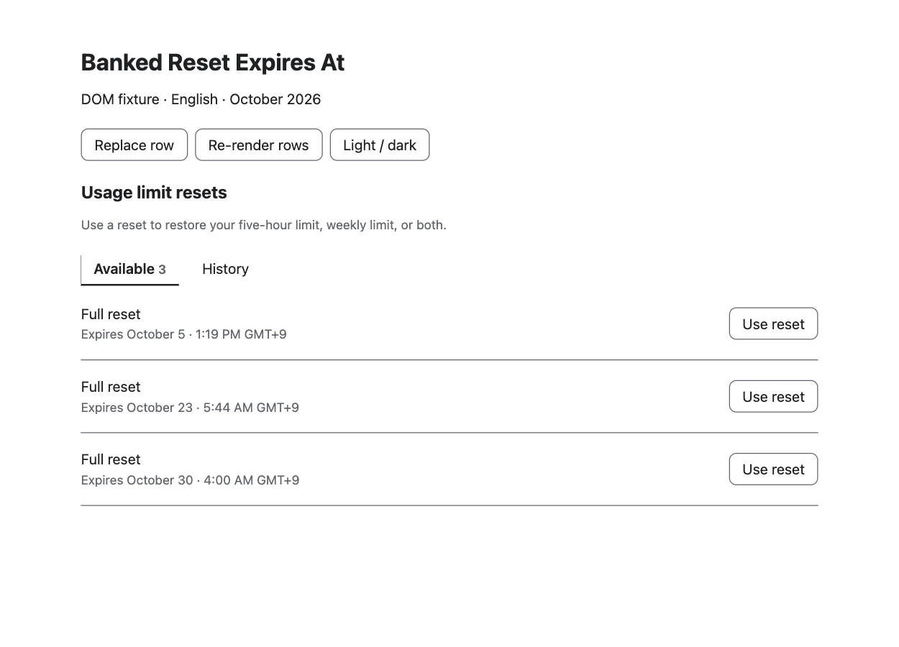
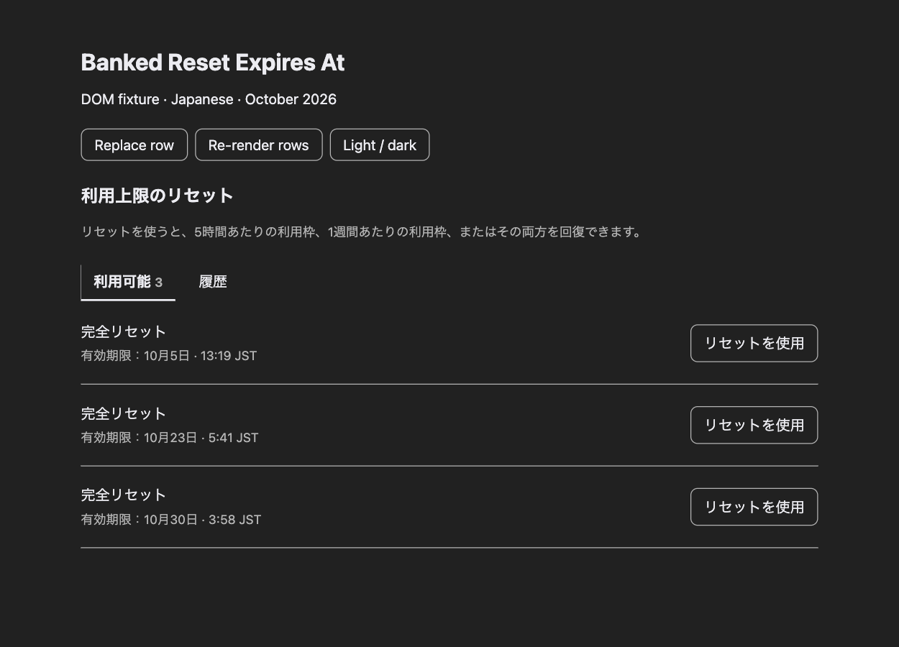

# Banked Reset Expires At

A Chrome extension that always shows expiry times in ChatGPT's **Usage limit resets** list. It appends the time and timezone from each row's `title` attribute to the existing date.

- English UI: `Expires October 5 · 1:19 PM GMT+9`
- Japanese UI: the original localized date followed by ` · 13:19 JST`

A date alone does not tell you when a reset expires. In the supplied API data, resets expired exactly 30 days after being granted, not at the end of the expiry date. This extension does not calculate expiry dates; it displays information already provided by ChatGPT.

## Build and load in Chrome

Use Node.js 24 and pnpm. The pnpm version is pinned in the `packageManager` field of `package.json`. If you use Corepack, run `corepack enable` first.

```sh
pnpm install --frozen-lockfile
pnpm build
```

1. Open `chrome://extensions` in Chrome.
2. Enable **Developer mode**.
3. Click **Load unpacked** and select this repository's **`dist` directory**.
4. Log in to ChatGPT and open the [usage page](https://chatgpt.com/settings/usage?tab=overview). Reload the page if it was already open.
5. Check that each reset's expiry time appears after its date.

After changing the source, run `pnpm build` again, reload the extension, and reload the ChatGPT page. The development server's HMR does not update an installed extension.

Run `pnpm package` to create `banked-reset-expires-at.zip`. To install from the ZIP, extract it and load the extracted directory in Chrome.

## Screenshots

These screenshots show fixtures based on the supplied DOM, not the live ChatGPT page. Fixture-only CSS supplies the styling omitted from the original Tailwind classes.

### English UI, light theme



### Japanese UI, dark theme



## Check re-rendering with fixtures

```sh
pnpm dev
```

Open `/fixtures/en.html` or `/fixtures/ja.html` using the URL printed in the terminal. The fixtures load TypeScript, so serve them through Vite rather than opening them directly with `file://`.

- **Replace row** replaces the first row with new DOM.
- **Re-render rows** rebuilds the list from its original HTML.
- **Available / History** switches panels; the Japanese fixture uses the corresponding localized tab labels.
- **Light / dark** switches background and text colors.

Repeating these actions should leave exactly one time suffix after each date. The fixtures' reset buttons are inert and do not consume resets. The live History row structure has not been inspected, so the fixtures contain an empty History panel rather than invented rows.

Repository documentation, comments, and development controls are written in English. Japanese UI strings are retained only as localization test data and in the corresponding screenshot.

## Implementation and permissions

Vite compiles `src/content.ts` into a single `dist/content.js` and copies `public/manifest.json` and `public/content.css` into `dist`. The extension uses only Manifest V3 content scripts.

The match pattern is `https://chatgpt.com/*`, allowing the script to handle SPA navigation from chat to settings without requiring a page reload.

Within each `[role="tabpanel"]` referenced by a tablist's `aria-controls`, the script follows `button[aria-describedby]` references. It processes only spans in the same panel whose `title` contains a time in `H:MM` format. Selectors do not depend on localized labels, Tailwind classes, or React-generated ID patterns.

A regular expression extracts the trailing time and timezone. If that extraction fails, the full `title` is displayed. Titles without a time are ignored. History rows are processed only if they have the same accessibility relationships.

JavaScript changes only the `data-bre-time` attribute. CSS `::after` displays the suffix without changing the original text, child nodes, or accessibility attributes. Text color is inherited from the parent. `MutationObserver` updates are batched with `requestAnimationFrame`, and the extension's own attribute changes are excluded from observation. Changed titles or references update the suffix; elements that no longer qualify have the added attribute removed.

There are no `host_permissions`, storage access, background scripts, external requests, or ChatGPT API calls. Remaining-time estimates and estimated grant dates are not implemented.

## Development and verification

The Vite, TypeScript, Vitest, pnpm, oxlint, oxfmt, and GitHub Actions setup is based on [confluence-copy-md-extension](https://github.com/mkusaka/confluence-copy-md-extension). A single content script does not need CRXJS or Chrome API type definitions.

```sh
pnpm test
pnpm typecheck
pnpm lint
pnpm format:check
pnpm build
```

Vitest covers English and Japanese output, DOM preservation across repeated updates, multiple description IDs, unfamiliar title formats, unrelated elements, SPA insertion, re-rendering, attribute changes, and removal of stale suffixes. Observer tests use fake timers.

CI runs the checks above. Pushing a `v*` tag triggers the release workflow, which uploads the extension ZIP to GitHub Releases.

## Release 0.1.0

The initial release includes:

- Always-visible expiry times from ChatGPT's existing tooltip data.
- English and Japanese UI support, with full-title fallback for unfamiliar formats.
- SPA navigation and re-rendering support without duplicate suffixes.
- Inherited theme colors and no permissions beyond content script injection.

To prepare the release archive locally, run `pnpm package`. The archive contains only `manifest.json`, `content.js`, and `content.css`; its manifest version is `0.1.0`.

After the release commit is pushed and CI passes, publish the release by creating and pushing the matching tag:

```sh
git tag v0.1.0
git push origin v0.1.0
```

The tag push publishes a GitHub Release and attaches `banked-reset-expires-at.zip`. It does not publish to the Chrome Web Store.

## Verified behavior and limitations

Browser verification covered row replacement, re-rendering, tab switching, and both light and dark themes in the English and Japanese fixtures. The built `dist` directory was also loaded as an unpacked extension in local Chrome. With a fixture substituted for a response on `https://chatgpt.com`, verification confirmed automatic content script and CSS injection, no duplicate suffixes, and updates after SPA navigation. This is fixture verification, not verification against live account data.

**Not verified:** the live usage page of a logged-in account. The actual URL was opened, but the verification browser was logged out and did not show the usage tab. Connecting to the existing browser also timed out. The live reset list and History row structure remain unverified.

If times do not appear, inspect the button's `aria-describedby`, the referenced span's `title`, and the tab's `aria-controls`. Report problems through [GitHub Issues](https://github.com/mkusaka/banked-reset-expires-at/issues). Remove account information before sharing HTML.
